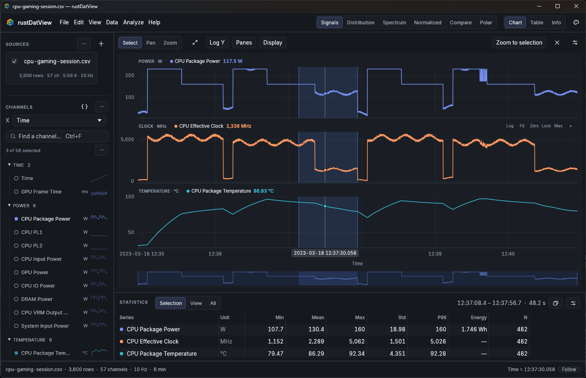

<p align="center">
  
</p>

<p align="center"><b>Open a log. See the story.</b><br>
A fast, beautiful desktop viewer for engineering data — CPU and GPU telemetry, power and energy, clocks and temperatures, scope and power-analyzer exports, and simulation outputs.</p>

<p align="center">
  
</p>

rustDatView reads the file you already have — an HWiNFO or LibreHardwareMonitor log, a GPU-Z sensor log, an MSI Afterburner `.hml`, a PresentMon capture, a scope CSV, an OpenFAST output — and shows it the way you would have arranged it yourself: time on X, channels grouped into panes by unit, live values under the cursor, and statistics for any range you drag across. Everything else is one click or one keystroke away.

It is a ground-up Rust re-imagining of [pyDatView](https://github.com/ebranlard/pyDatView) and keeps all of its analysis power.

## Download

Windows 10/11 (x64): download `rustDatView-…-windows-x86_64.zip` from [Releases](https://github.com/exror/rustDatView/releases), extract it and run `rustDatView.exe`. No installer, runtime, Python or Rust needed. The archive contains example files to try.

The executable is not code-signed, so SmartScreen may ask for confirmation the first time. Compare the archive with `SHA256SUMS.txt` from the release if you want to verify it.

## The everyday loop

1. **Open** — drag files onto the window, use <kbd>Ctrl</kbd>+<kbd>O</kbd>, or pass them on the command line. Hold <kbd>Ctrl</kbd> while dropping to add to what is already open. Large files load in the background.
2. **See** — rustDatView picks the time axis and a sensible first set of channels (package power, effective clock, package temperature for CPU logs) and stacks them in panes by unit: Power · W, Clock · MHz, Temperature · °C, Flags · Yes/No.
3. **Find channels** — type in the channel search (<kbd>Ctrl</kbd>+<kbd>F</kbd>): `core clock`, `vrm | soc`, `gpu temp`. Click to plot, <kbd>Shift</kbd>-click for a range, <kbd>Alt</kbd>-click to plot only that channel. Each channel shows its unit and a sparkline.
4. **Read values** — hover anywhere: every pane shows the value of every series at that instant, and a time pill marks the position.
5. **Select a range** — drag across the chart. The statistics dock instantly shows min, mean, max, standard deviation, P99 and **energy** (W integrated over seconds, shown in J, kJ or Wh) for that range. Double-click inside it to zoom in.
6. **Share** — <kbd>Ctrl</kbd>+<kbd>Shift</kbd>+<kbd>C</kbd> copies the chart as an image; <kbd>Ctrl</kbd>+<kbd>E</kbd> exports PNG, SVG, PDF or EPS with a live preview. Statistics copy straight into Excel.

## Navigating the chart

| Action | How |
| --- | --- |
| Zoom time | Mouse wheel (or pinch) |
| Zoom one pane's Y | <kbd>Ctrl</kbd>+wheel, or wheel over its Y axis |
| Pan | Right- or middle-drag, <kbd>Shift</kbd>+wheel, <kbd>←</kbd>/<kbd>→</kbd> |
| Box zoom | <kbd>Ctrl</kbd>+drag, or the Zoom tool |
| Select a range | Drag (Select tool); drag its edges to adjust; <kbd>Esc</kbd> clears |
| Fit everything | Double-click, <kbd>Home</kbd> |
| Back / forward through views | <kbd>Alt</kbd>+<kbd>←</kbd> / <kbd>Alt</kbd>+<kbd>→</kbd> |
| Hide or solo a series | Click / <kbd>Alt</kbd>-click its legend entry |
| Pane options | Hover a pane: log scale, fit Y, include zero, lock Y, maximize, remove |

The overview strip under the chart shows the whole recording; drag its window to move through time.

## Comparing runs

Open two logs of the same benchmark — for example `examples/cpu-benchmark-eco.csv` and `examples/cpu-benchmark-performance.csv` — and the same channels from both are overlaid, colored by run. Align their starts with one click, shift either run in time, and turn on **Compare to** in the statistics dock to see the difference in mean, max and energy against the reference run. The **Compare** mode plots relative or absolute differences, ratios or one run against the other.

## Beyond plotting

- **Modes** — Signals, Distribution (PDF/KDE), Spectrum (FFT/PSD with Welch averaging, windows and detrending), Normalized (min/max scaling), Compare and Polar, each with plain-language options.
- **New channels** (<kbd>Ctrl</kbd>+<kbd>N</kbd>) — formulas such as `{CPU Package Power} + {GPU Power}`, with templates for sum, difference, ratio, efficiency, rate of change, running energy (`cumtrapz`) and moving average, and a live preview. Formulas survive reloads.
- **Processing** — masks (`{Time} > 30 and {CPU Package Power} < 150`), moving-average/low-pass/high-pass filters, resampling, binning, outlier removal, unit standardization and OpenFAST nodal tools, as an ordered list of steps you can save and reuse.
- **Analyze** — curve fitting (polynomial, exponential, sinusoid, Gaussian, second-order responses, custom formulas), damping from a decaying oscillation, rainflow fatigue equivalent loads, and a full statistics report — all on the selected range.
- **Marks** — point annotations, highlighted regions, event markers and reference lines (TjMax, PL1, PL2) that appear in exported figures.
- **Table and file info** — a fast data grid synced to the chart cursor, and what the reader detected (encoding, delimiter, units, skipped header rows).
- **2D fields** — color maps of 2D fields from VTK, TurbSim and other field files, Cartesian or polar.
- **Sessions** — <kbd>Ctrl</kbd>+<kbd>S</kbd> saves files, channels, panes, styles, marks, processing and the view to a `.dvsession`; open it later, even after the logs have been regenerated.
- **Export** — figures (PNG, SVG, PDF, EPS), data (CSV, Parquet, OpenFAST binary), statistics (TSV, CSV, Markdown) and a Python script that reproduces the chart.
- **Follow** — watch files that are still being written and keep the newest data in view.
- **Command palette** (<kbd>Ctrl</kbd>+<kbd>K</kbd>) — every command, channel and source by name. <kbd>F1</kbd> lists all shortcuts.

## Files it understands

Delimited text is detected from its content, not its extension:

- UTF-8 (with or without BOM), UTF-16 and Windows-1252 encodings; comma, semicolon, tab, pipe and whitespace delimiters; decimal commas.
- Metadata preambles (oscilloscopes, power analyzers, PTAT), separate units rows, LibreHardwareMonitor's two-row header, repeated header rows from concatenated logs, trailing delimiters and padded fields.
- Units in brackets or parentheses, values with unit suffixes (`45.20 W`, `1500 MHz`), `N/A`, `[N/A]` and `-` as missing values, `Yes`/`No` flags, hexadecimal values.
- Separate Date and Time columns are merged into one timestamp; day/month order is inferred from the data (Settings has a day-first override).
- Duplicate channel names are kept apart (`GPU Fan [RPM]`, `GPU Fan #2 [RPM]`).

Dedicated readers cover MSI Afterburner `.hml`, Excel, Parquet, NetCDF, MATLAB, TDMS, VTK, pickle tables (decoded without executing Python), and the OpenFAST, TurbSim, HAWC2, HAWCStab2, FLEX, Bladed, BModes, ROSCO, Tecplot, GNUplot, CACTUS and Mann-box formats from pyDatView. **File → Open with format…** forces a specific reader.

## Command line

```text
rustDatView.exe [OPTIONS] [FILE ...]

  -f, --format NAME     Reader format (default: detect)
  --dayfirst            Read ambiguous dates as day/month/year
  --mode MODE           Signals, Distribution, Spectrum, Normalized, Compare or Polar
  --x INDEX             X column (zero-based, including Index)
  --y INDEX[,INDEX]     Y columns
  --pipeline PATH       Apply a saved processing pipeline (JSON)
  --session PATH        Open a .dvsession
  --follow              Watch the files for new data
  --export PATH         Write a figure (.png .svg .pdf .eps) or Python script (.py) and exit
```

For example, `rustDatView.exe run.csv --mode Spectrum --export spectrum.png` renders a spectrum without opening a window.

## Building from source

Install stable Rust from [rustup.rs](https://rustup.rs/) and the Visual Studio C++ build tools, then:

```sh
cargo build --release -p datview --locked
cargo test --workspace --locked
```

The executable is `target/release/datview.exe`.

| Crate | Responsibility |
| --- | --- |
| `dv-core` | Tables, columns, units, formulas and masks |
| `dv-io` | File detection, readers and writers |
| `dv-tools` | Statistics, spectra, filters, fitting, damping, fatigue, colormaps |
| `dv-plot` | Plot transforms, comparisons, processing pipelines, Python export |
| `dv-chart` | Interactive chart engine with min/max decimation and matching SVG output |
| `datview` | The desktop application |

## License

MIT. rustDatView builds on pyDatView by E. Branlard (MIT); bundled fonts, icons and palette data are credited in [THIRD_PARTY_NOTICES.md](THIRD_PARTY_NOTICES.md). The example telemetry files are synthetic.
