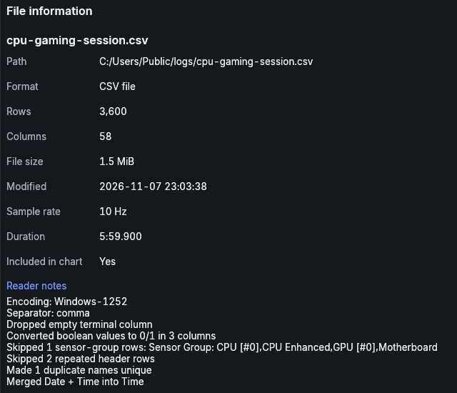
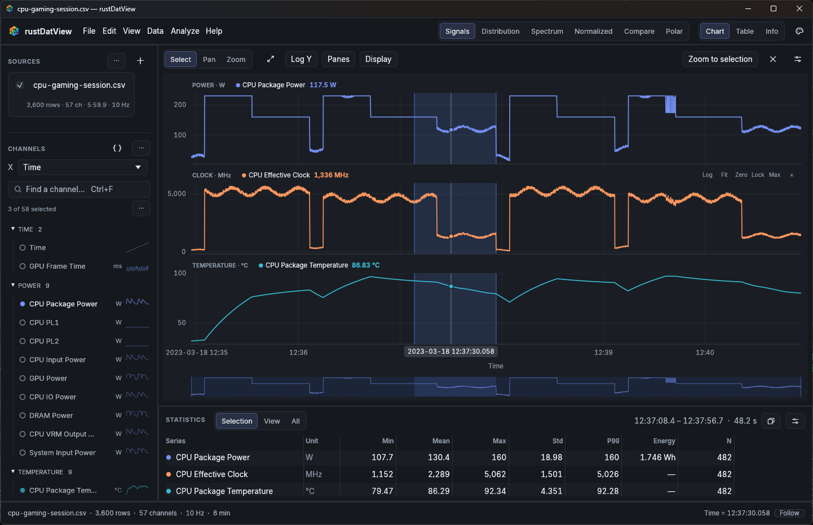
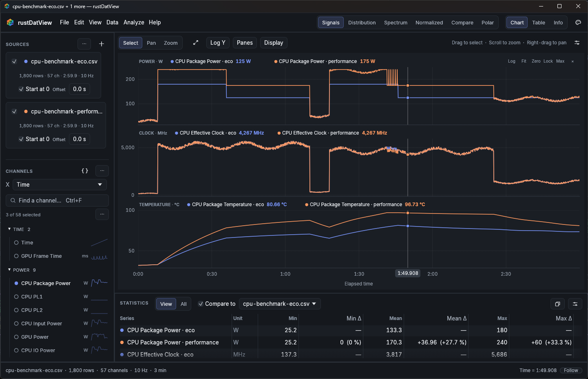
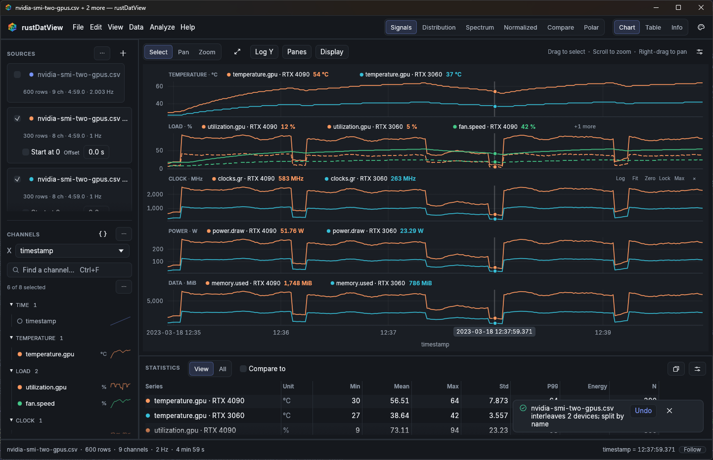
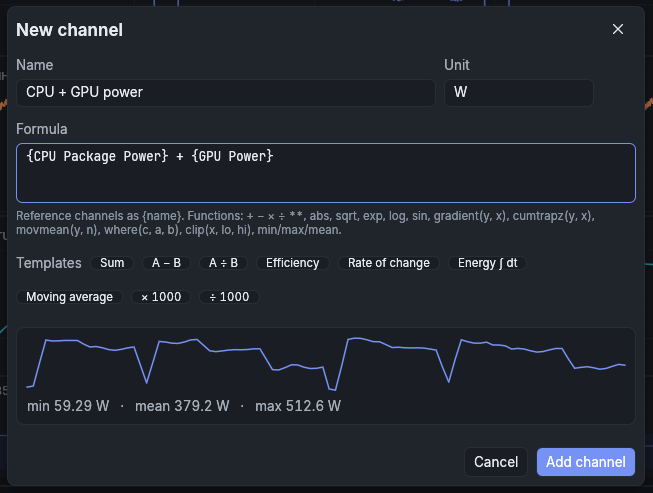
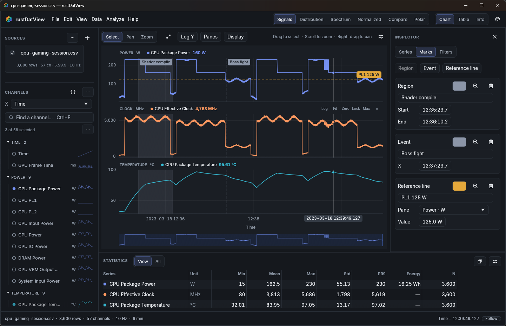
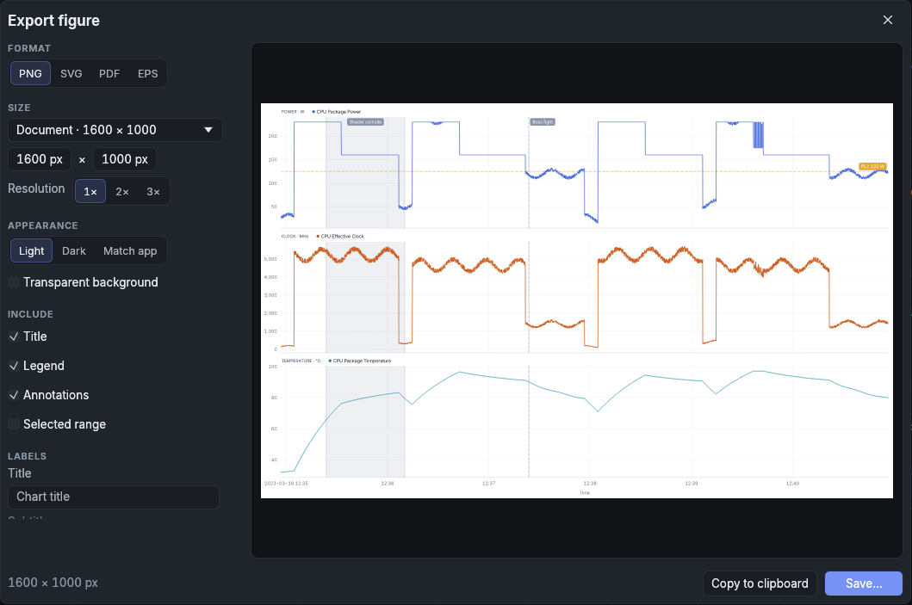

# rustDatView quick start

A ten-minute tour of the things rustDatView does for you that usually take manual work in a spreadsheet or a general-purpose plotter. Every step uses the files in the `examples` folder of the release archive; most are also on the welcome screen under **Open sample data**.

The [user guide](USER_GUIDE.md) describes everything else.

1. [Open a raw log and get a useful chart](#1-open-a-raw-log-and-get-a-useful-chart)
2. [Measure any stretch, including energy](#2-measure-any-stretch-including-energy)
3. [Compare two runs without lining them up by hand](#3-compare-two-runs-without-lining-them-up-by-hand)
4. [Separate devices that share one log](#4-separate-devices-that-share-one-log)
5. [Add a calculated channel](#5-add-a-calculated-channel)
6. [Mark what happened](#6-mark-what-happened)
7. [Export exactly what you see](#7-export-exactly-what-you-see)
8. [Keep the whole investigation](#8-keep-the-whole-investigation)
9. [Repeat it without opening the window](#9-repeat-it-without-opening-the-window)
10. [Watch a log while it is being written](#10-watch-a-log-while-it-is-being-written)

## 1. Open a raw log and get a useful chart

Drag `examples/cpu-gaming-session.csv` onto the window (or **Open sample data → CPU gaming session**).

This is a HWiNFO-style log: Windows-1252 encoded, separate `Date` and `Time` columns, `Yes`/`No` flags, a trailing comma on every line, a duplicated sensor name, and the repeated header and *Sensor Group* rows HWiNFO appends at the end. There is no import dialog. The file opens with:

- one `Time` axis, merged from Date and Time;
- three channels chosen for a CPU log (package power, effective clock and package temperature);
- one pane per unit: `POWER · W`, `CLOCK · MHz`, `TEMPERATURE · °C`.

Press <kbd>Ctrl</kbd>+<kbd>3</kbd> to see what the reader did, and <kbd>Ctrl</kbd>+<kbd>1</kbd> to return to the chart.

<p align="center"></p>

The same works for semicolon-separated files with decimal commas, UTF-16 exports, oscilloscope and power-analyzer CSVs with preambles and units rows, LibreHardwareMonitor's two-row header, and values with units in the cells (`58.46 W`).

To plot something else, type in **Find a channel…** (<kbd>Ctrl</kbd>+<kbd>F</kbd>). Words can be abbreviated and given in any order: `pkg pwr`, `vrm temp`. <kbd>Alt</kbd>-click a channel to plot only that one.

## 2. Measure any stretch, including energy

In the gaming session, drag across one of the high-load stretches.

<p align="center"></p>

The statistics dock switches to **Selection** and shows the range (`12:37:08.4 – 12:37:56.7 · 48.2 s` above) and, for each series, Min, Mean, Max, Std, P99, **Energy** and N. Energy is the power channel integrated over time, in J, kJ, Wh, MJ or kWh as appropriate. Drag the selection's edges to adjust it; the numbers follow.

- Double-click inside the selection to zoom in. <kbd>Alt</kbd>+<kbd>←</kbd> goes back.
- The sliders button in the dock offers 30 statistics. Turn on **Time above threshold** and set **Threshold** to `125` to see how long the package spent above its 125 W PL1.
- The copy button copies the table for Excel, as CSV or as Markdown.

## 3. Compare two runs without lining them up by hand

Open `examples/cpu-benchmark-eco.csv` and `examples/cpu-benchmark-performance.csv` together (select both in **Open file…**, drop both, or **Open sample data → Compare two benchmark runs**).

The two runs were recorded at different times. rustDatView notices that they do not overlap and starts both at zero: the notification says `2 separate recordings aligned at their start` and offers **Undo**. The X axis becomes elapsed time, and each series is labelled with the part of the file name that differs: `CPU Package Power · eco`, `CPU Package Power · performance`. If one run started its workload later, shift it with its **Offset** field.

Now tick **Compare to** in the statistics dock:

<p align="center"></p>

Every statistic gets a Δ column against the reference run, with the relative difference in brackets: the performance run's package power is `+36.96 (+27.7 %)` higher on average. Select a range first to compare just that part. Logs recorded at the same time (for example a CPU logger and a power meter) keep their absolute timestamps.

## 4. Separate devices that share one log

Open `examples/nvidia-smi-two-gpus.csv`. nvidia-smi writes one row per GPU per timestamp, so plotted directly, every channel zig-zags between the two cards.

<p align="center"></p>

rustDatView spots the repeating timestamps and the column that tells the rows apart, and splits the file into one source per GPU: `nvidia-smi-two-gpus.csv interleaves 2 devices; split by name`, with **Undo**. Each card gets its own line, labelled `RTX 4090` and `RTX 3060`. The values in this file carry their units (`58.46 W`, `640 MHz`, `14 %`) and missing readings are written `[N/A]`; both are handled.

The same happens for Intel PTAT and turbostat logs with per-core rows. Any source can be split by hand: right-click it → **Split by…**. The **⋯** menu above the sources can also merge sources on a common X axis or stack their rows. Sessions remember how these sources were made and rebuild them from the original files.

## 5. Add a calculated channel

In the gaming session, press <kbd>Ctrl</kbd>+<kbd>N</kbd> and fill in:

- **Name** `CPU + GPU power`, **Unit** `W`
- **Formula** `{CPU Package Power} + {GPU Power}` (type `{` and the channel names are suggested)

<p align="center"></p>

The preview shows the result's shape and range before you add it. **Add channel** plots it in the power pane, and it gets statistics, including energy, like any other channel. The formula is applied again when the file is reloaded or followed, and is saved in sessions.

The templates write common formulas from the channels you have selected: sum, difference, ratio, efficiency, rate of change, running energy (`cumtrapz`) and moving average. Formulas also support comparisons, `where(…)`, `clip(…)` and numpy-style functions; see the [formula syntax](USER_GUIDE.md#formula-syntax).

## 6. Mark what happened

Still in the gaming session, open the inspector (<kbd>Ctrl</kbd>+<kbd>I</kbd>) and choose **Marks**.

1. Select a range on the chart and click **Region**. Rename it, for example `Shader compile`.
2. Right-click the chart where something happened → **Add event marker here**, and label it `Boss fight`.
3. Click **Reference line**, choose the `Power · W` pane, set the value to `125 W` and label it `PL1 125 W`.

<p align="center"></p>

Times are edited as clock times (`12:35:23.7`) because the X axis is a timestamp. The zoom button beside each mark jumps to it. Marks are included in exported figures and saved in sessions.

## 7. Export exactly what you see

Press <kbd>Ctrl</kbd>+<kbd>E</kbd>.

<p align="center"></p>

The preview on the right is the file you will get. Pick PNG, SVG, PDF or EPS, a size preset (Slide, Document, Square, Wide) or your own, a resolution, and a light or dark look independent of the app's theme. Add a title and subtitle, or override the axis labels. **Copy to clipboard** pastes straight into chat, slides or a ticket.

Without the dialog: <kbd>Ctrl</kbd>+<kbd>Shift</kbd>+<kbd>C</kbd> copies the chart with the last export settings. **File → Export data…** (<kbd>Ctrl</kbd>+<kbd>Shift</kbd>+<kbd>E</kbd>) saves the plotted channels, or every column, for all rows, the visible range or the selection, as CSV or Parquet.

## 8. Keep the whole investigation

Press <kbd>Ctrl</kbd>+<kbd>S</kbd> and save a `.dvsession` file. It records the files, generated sources (splits and merges), offsets, formula channels, plotted channels, mode, panes, styles, marks, filters, processing steps and the zoomed view. The data stays in your log files.

Open it later with **File → Open session…** or from **RECENT SESSIONS** on the welcome screen. If the logs have been moved, the warning button in the status bar lists them with **Locate…**: point to the new location and the session finishes loading. If the logs have been regenerated with new data, the session shows the new data with the same layout.

## 9. Repeat it without opening the window

Every view can be rendered from the command line:

```text
rustDatView.exe examples\signals.csv --mode Spectrum --export spectrum.png
rustDatView.exe --session tuning.dvsession --export tuning.pdf
```

With a session, the export has the session's channels, panes, styles, marks and zoom. The command exits with 1 and prints `Export failed: …` if anything goes wrong, so it can run in a script or CI job.

To continue in Python, **File → Export Python script…** writes a script that reproduces the chart from the source files, including processing steps and formulas, using pyDatView, welib or the OpenFAST toolbox. `--export chart.py` does the same from the command line.

## 10. Watch a log while it is being written

Start your logger, open its file and click **Follow** in the status bar. When the file grows, rustDatView reloads it, applies formulas and processing again, and keeps the newest samples in view if you were looking at the end. Scroll back and it stays where you put it. Settings → **Follow files** turns this on for every launch.

## Where next

- <kbd>Ctrl</kbd>+<kbd>K</kbd> opens the command palette: every command, channel and source by name.
- <kbd>Alt</kbd>+<kbd>2</kbd> to <kbd>Alt</kbd>+<kbd>6</kbd> switch to the [Distribution, Spectrum, Normalized, Compare and Polar modes](USER_GUIDE.md#modes).
- [Filters](USER_GUIDE.md#filters) hide warm-up periods or outliers without changing the data, and the statistics follow.
- The **Analyze** menu has [curve fitting, damping, fatigue and a full statistics report](USER_GUIDE.md#analyze-tools).
- <kbd>F1</kbd> lists every keyboard shortcut.
